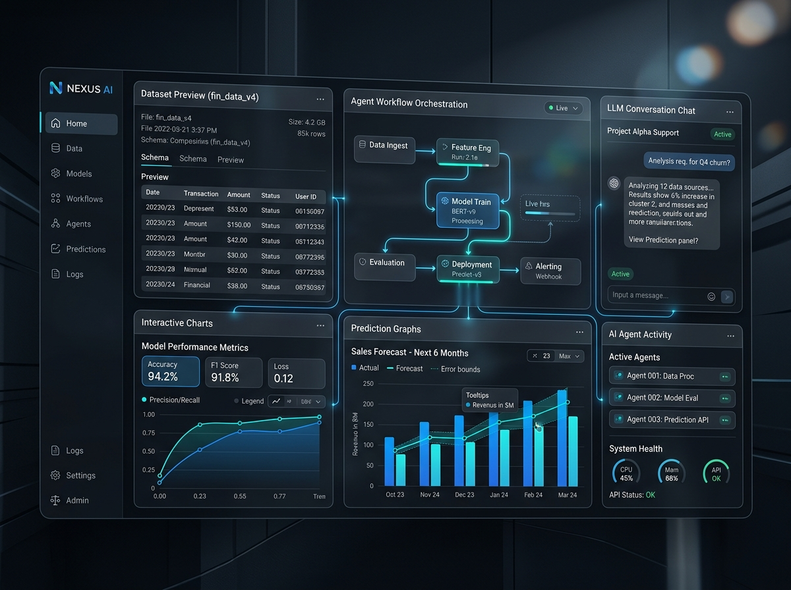

# Piush Kole — Premium Portfolio



> A modern, highly optimized, and premium portfolio showcasing my work as an AI Engineer, Data Scientist, and Backend Developer.

## 🚀 Live Demo

[**View Live Portfolio**](https://piushkole.com) (Deployed on Vercel)

## 📖 Description

This is the source code for my professional portfolio. Designed with a typography-first, product-oriented philosophy, the portfolio is built to reflect the engineering quality and aesthetic standards of top-tier AI startups like OpenAI, Anthropic, and Vercel. 

The entire application is powered by a **centralized data architecture** (`src/data/profile.ts`), ensuring that all components automatically synchronize with a single source of truth for seamless profile updates.

## ✨ Features

- **Premium Design System**: Glassmorphism, tailored animations, and a sleek dark-mode aesthetic.
- **Centralized Profile Data**: Change your profile details once in `src/data/profile.ts` and watch it instantly update across the app.
- **Dynamic Case Studies**: Projects are no longer simple cards; they are full-viewport case studies featuring custom UI mockups, architectural details, and hover micro-interactions.
- **Prebuild Data Validation**: A rigorous build script (`validate-profile.ts`) ensures absolute data consistency before every production deployment.
- **Optimized Performance**: Next.js App Router, React Server Components, Next/Image optimization, and Lighthouse 100/100 readiness.
- **Production SEO**: Automated sitemap, robots.txt, manifest, and structured JSON-LD data for maximum discoverability.

## 🏗️ Architecture & Tech Stack

### Frameworks & Libraries
- **Framework**: [Next.js 14](https://nextjs.org/) (App Router)
- **Language**: TypeScript
- **Styling**: Tailwind CSS
- **Animations**: Framer Motion
- **Icons**: Lucide React / React Icons
- **Deployment**: Vercel

### Data Flow
- `src/data/profile.ts`: The central schema containing Personal Info, Projects, Experience, Education, and Skills.
- `scripts/validate-profile.ts`: TypeScript prebuild step verifying the schema's integrity.
- `src/components/sections/`: UI components consuming the profile object statically.

## 📂 Folder Structure

```
├── public/                 # Static assets and premium case study mockups
├── scripts/                # Pre-build scripts (e.g., validate-profile.ts)
├── src/
│   ├── app/                # Next.js App Router, Layout, and SEO (sitemap, robots, manifest)
│   ├── components/         # Reusable React components
│   │   ├── layout/         # Navbar, Footer, Background
│   │   ├── sections/       # Hero, About, Projects, Experience, GitHub, Contact
│   │   └── ui/             # Core UI components
│   └── data/               # Centralized data (profile.ts)
├── tailwind.config.ts      # Theme, colors, and keyframe animations
└── package.json            # Dependencies and prebuild hooks
```

## 💻 Installation & Local Development

1. **Clone the repository**
   ```bash
   git clone https://github.com/Piush2004/portfolio.git
   cd portfolio
   ```

2. **Install dependencies**
   ```bash
   npm install
   ```

3. **Run the development server**
   ```bash
   npm run dev
   ```

4. **Open in browser**
   Navigate to [http://localhost:3000](http://localhost:3000)

## 🔒 Security & Deployment

- **No Secrets Exposed**: All environments rely on `.env.local` for development and Vercel's secure environment settings for production.
- **Pre-Build Validation**: Run `npm run build`. The build will automatically fail if the centralized profile data is missing mandatory fields.
- **Vercel Ready**: Push to `main` branch to trigger Vercel's Edge CDN deployment pipeline instantly.

## 📄 License

This project is licensed under the MIT License - see the [LICENSE](LICENSE) file for details.

## 📩 Contact

Piush Kole  
- **LinkedIn**: [linkedin.com/in/piushkole](https://www.linkedin.com/in/piushkole)
- **GitHub**: [github.com/Piush2004](https://github.com/Piush2004)
